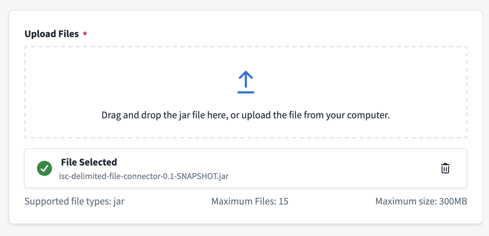

# ISC Delimited File connector

This repository contains the implementation for a custom connector improving on SP ISC's out of box Delimited File functionality.

## Features

This connector is an on-premises Java connector that executes via the ISC VA.

It can retrieve files from the following store types: local, FTP, FTPS, SFTP, SMB (Windows share), HTTP, AWS S3, Google Cloud Storage, and Azure Blob Storage. For testing, file contents can also be passed via the Source configuration. Remote files are copied to a local temp directory and then parsed from there as a local file.

The connector uses the FastCSV Java library to parse the CSV file.

Empty lines and comment lines (starting with `#`) are skipped by default. 

Quoted field values are handled automatically.

The file Header row will be parsed automatically and used to interpret the remaining rows. If the file does not contain a Header row, you must supply a list of fields via configuration.

## Installation

### Deploying the connector files

The connector files in the `config` directory **must** be deployed to your ISC instance using the API. 

The provided `deploy.py` Python script will take care of this for you. You must provide an access token and a tenant base URL, either via command line (`--token` and `--tenant`) or via properties in a `.env` file.

### Creating a Source in ISC

Once the connector has been installed, you may create a Source using the usual method. The source type will be `DelimitedFileDirectConnector`. 

In the Source configuration, you **must** upload the JAR file produced by building this library. If a previous version of this library is already uploaded, you **must** remove it.

## Problems with the OOTB connector

The primary issue is that the OOTB connector is a "push only" connector. In other words, someone needs to invoke the API (manually or via script) to upload the file on whatever schedule is needed. This requires on-premises infrastructure other than the SailPoint-provided VA and IQService.

Furthermore, the file handling is somewhat fragile, breaking on missing columns and comments, for example.